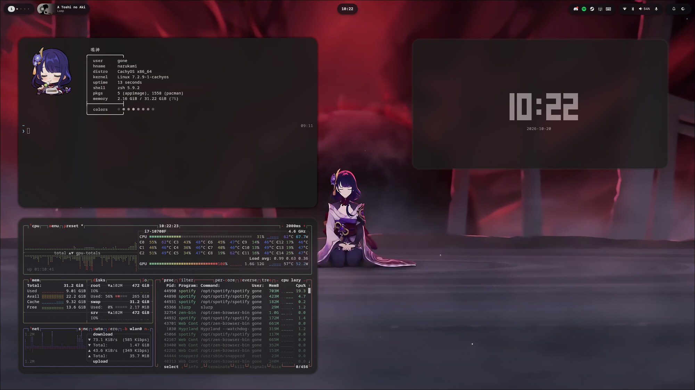

# dotfiles



```sh
git clone https://github.com/platanopp/dotfiles.git ~/dotfiles && cd ~/dotfiles && ./install.sh
```
Run `./install.sh --dry-run` first if you want to see what it would touch.

## Updating

Settings → About → Updates checks this repository each time the page opens
and, when there is a newer shell, lists what changed and installs it with
**Update**. It replaces `~/.config/quickshell` only: your settings
(`shell-settings.json`), your desktop widgets and files of your own stay, and
the shell as it was is copied to `~/.local/share/dotfiles-backups/<timestamp>/`
first. Hyprland, the terminal and the rest are left as you have them.

## Restoring

`install.sh` moves anything it would overwrite into
`~/.local/share/dotfiles-backups/<timestamp>/`, keeping the original paths, so
undoing a run is copying that tree back over `$HOME`.

## Paths into your home

A few configs name files by their absolute path (GTK bookmarks, qt6ct,
hyprpaper, qBittorrent, spicetify). The repo keeps `@HOME@` in those places and
`install.sh` writes your own home in, so copy them with it rather than by hand.
`sync.sh` puts `@HOME@` back when it copies a live config in.
