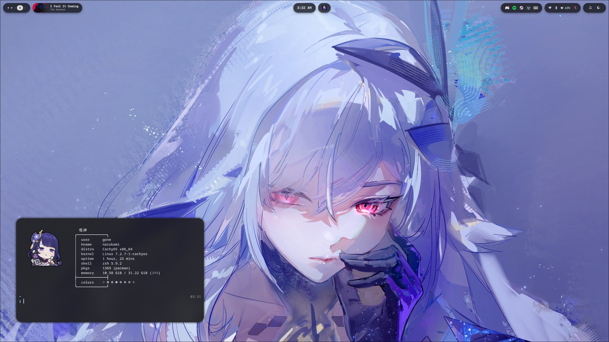

# quickshell

A desktop shell for [Quickshell](https://quickshell.org/), tuned for Hyprland on
Wayland.



## What is on screen

The bar is not one window. Every pill is its own layer surface, parked off the
live width of its neighbour, so a panel that expands pushes the others along
instead of growing out underneath them.

- **Left** — the workspace pill (the active workspace is labelled, the rest are
  dots, dimmer where the workspace is empty), then the media widget.
- **Centre** — the clock and date, and the quick-capture pill that writes
  straight into the Obsidian vault.
- **Right** — the system tray, then the status pill (network, Bluetooth,
  volume, microphone, battery), then the control panel.

The whole row hides itself while an app is fullscreen and comes back when the
pointer reaches the top of the screen.

Over the desktop, opened from the control panel or from a key: the launcher
(Super+Space), the workspace overview (Super+Tab), the wallpaper picker, a
keyboard shortcut sheet read out of the live Hyprland config, notification
toasts with do-not-disturb, screen recording, the Settings window, and a lock
screen the shell draws itself.

## How it is laid out

```
shell.qml        the entry point: one bar per screen, the overlays, global shortcuts
services/        state and logic, no UI -- one singleton per subject
config/          Theme (colours, type, motion) and ShellSettings (the user's choices)
bar/             the pills along the top and the panels they open
overlays/        full-screen or floating layers: launcher, overview, wallpapers,
                 keybinds sheet, notification toasts, the black screen cover
lock/            the lock screen and the engine behind it (PAM, the session lock)
settings/        the Settings window, its building blocks, and pages/ -- one per page
components/      small pieces used everywhere: icons, buttons, switches, sliders
scripts/         the helpers the QML shells out to (Python, shell, Lua)
```

Views mostly read a service's properties and call its functions rather than
run commands of their own, so to see how something works, start from its
service.

| Service | What it holds |
| --- | --- |
| `Audio` | Volume and mute, output and input devices, the microphone, per-app streams |
| `Network` | Wi-Fi and wired state, the scan list, connecting |
| `Bluetooth` | Power, devices, scanning, pairing |
| `Wallpaper` | Pictures and videos, the crop hyprpaper shows, pausing a video under a fullscreen window |
| `KeyboardRgb` | The Wooting keyboard's colours, taken from the wallpaper |
| `Panels` | Which panel or overlay is open and where; Escape, the IPC targets, Hyprland's `shell-modal` submap |
| `Keybinds` | Hyprland's and Yazi's binds, for the shortcut sheet |
| `Recorder` | Screen recording: the countdown, the timer, the file |
| `Display` | Monitors: mode, scale, layout, VRR, colour; keep-or-revert |
| `Hypr` | Hyprland options for Settings, and the gaps the bar lines up with |
| `Power` | Battery, power profile, idle timeouts, lock and suspend |
| `Profile` | User name and avatar |
| `System` | Distribution, About, the dotfiles backup |
| `Tablet` | OpenTabletDriver on and off |
| `Notes` | The Obsidian quick-capture note |
| `Clock` | The time and date |
| `Notifications` | The notification server, the centre and the toasts |
| `Spectrum`, `AlbumColors` | The media widget's spectrum ring and its colour |
| `SteamGames`, `LauncherHistory` | The launcher's Steam library, and what it has opened most |
| `Weather` | Current conditions and the forecast, for the clock's panel and the lock screen |

A file uses another folder's types by importing it: `import qs.services`,
`import qs.components`, and so on. Files in the same folder see each other
without one.

`Bluetooth` and `Network` share their names with singletons in Quickshell's
own `Quickshell.Bluetooth` and `Quickshell.Networking` modules. A file that
needs one of those as well imports it with a qualifier (see
`lock/LockEngine.qml`).

## Running it

The config sits at `~/.config/quickshell/shell.qml`, which Quickshell picks up
as the default:

```sh
qs
```

It reloads itself when a file changes, so there is nothing to restart while
editing.

Colours, type and the motion scale all come from `config/Theme.qml`; nothing
else should be hardcoding a hex or a duration. `shell-settings.json` holds what
the Settings window changes.
